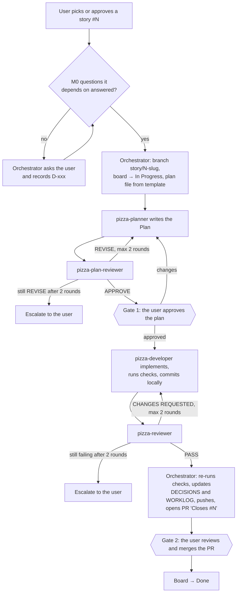

# Subagent Guidelines and Workflow

How AI subagents are used on this project: who does what, what context each one gets, what it must
produce, and the gates between them. The main Claude Code session is the **orchestrator**. It owns the
conversation with the user, briefs each subagent, checks its output, and keeps the logs.

> The agent definitions live in [`.claude/agents/`](../.claude/agents/). This document is the contract
> they follow. If the two disagree, this document wins; fix the agent file.

---

## 1. Principles

1. **One story at a time per developer.** Every subagent run is tied to one GitHub issue (`#N`) and its
   plan file, `docs/plans/<N>-<slug>.md`.
2. **Plan → review → build → review.** No code without an approved plan. Nothing is done until the
   review traces it back to the story's acceptance criteria.
3. **Subagents start cold.** They don't see this conversation. Everything they need is in the **brief**
   (section 5) plus the files it points to. If a subagent has to guess, the brief was incomplete.
4. **Written artifacts, not chat.** Plans, reviews and implementation notes go in the plan file, so the
   process is visible in the repo. That's useful evidence for the README's *AI usage note*.
5. **Stop and ask rather than invent.** If a subagent finds the plan or story is ambiguous, contradicts
   an M0 decision, or needs an unplanned pattern, it reports back. It doesn't improvise.
6. **The user decides.** Any `needs-decision` question, and any change to an accepted `D-xxx`, goes to
   the user through the orchestrator.

---

## 2. Roles at a glance

| Role | Agent | Model | Can change | Input | Output |
|---|---|---|---|---|---|
| **Orchestrator** | main session | session model | feature branches, GitHub issues/PRs, the logs; **never pushes to `main`** | the user's request | briefs, commits, PRs, log updates |
| **Plan developer** | `pizza-planner` | opus | **only** its plan file | the story + context | the *Plan* section of `docs/plans/<N>-<slug>.md` |
| **Plan reviewer** | `pizza-plan-reviewer` | opus | **only** the *Plan review* section | the plan file + story | verdict **APPROVE / REVISE** + findings |
| **Developer** | `pizza-developer` | sonnet (opus for complex stories) | code, tests, docs the plan names; local commits on the story branch | the approved plan | code + tests + *Implementation notes* |
| **Code reviewer** | `pizza-reviewer` | opus | **only** the *Code review* section | the branch diff + plan + story | verdict **PASS / CHANGES REQUESTED** + traceability matrix |

- **Model choice:** planning and reviewing need judgment, so they use opus. Implementing an approved
  plan is more mechanical, so the developer defaults to sonnet. The orchestrator passes `model: opus` to
  the developer for stories with tricky concurrency or money logic (#10, #11, #16, #20).
- **None of the subagents may:**
  - push,
  - merge,
  - create or close issues or PRs,
  - edit `docs/DECISIONS.md` or `docs/WORKLOG.md` (the orchestrator does that from their reports),
  - change an accepted decision,
  - run destructive commands (`git reset --hard`, `docker compose down -v`, deleting the database volume).

---

## 3. Workflow



### Steps

| # | Who | What | Done when |
|---|---|---|---|
| 0 | Orchestrator | Confirm the story is the next one to work on. Check the `Depends on` issues and the M0 questions. | The user agrees; no unanswered `needs-decision` blocks it |
| 1 | Orchestrator | `git switch -c story/<N>-<slug>` from an up-to-date `main`. Move the board item to **In Progress**. Copy `docs/plans/_TEMPLATE.md` to `docs/plans/<N>-<slug>.md` and fill in the header. | Branch and plan file exist |
| 2 | `pizza-planner` | Read the story, related decisions and current code. Write the **Plan** section. | Plan is complete per the template (files, steps, tests, AC mapping, risks) |
| 3 | `pizza-plan-reviewer` | Review the plan against the story, the assignment's grading criteria, `DECISIONS.md` and the codebase. | Verdict written in **Plan review** |
| 4 | Orchestrator | On **REVISE**, send the findings back to the planner (step 2), at most 2 rounds. On **APPROVE**, show the user a summary. | **Gate 1:** the user approves the plan |
| 5 | `pizza-developer` | Implement exactly the approved plan, in the planned order. Run the checks (section 6). Commit locally on the story branch in logical steps (`Refs #N`). Fill in **Implementation notes**. | All checks green; notes record every deviation |
| 6 | `pizza-reviewer` | Review the branch diff (`git diff main...HEAD`) against the plan and the story. Re-run the checks. Fill the traceability matrix. | Verdict written in **Code review** |
| 7 | Orchestrator | On **CHANGES REQUESTED**, send the findings to the developer (step 5), at most 2 rounds. | Verdict is **PASS** |
| 8 | Orchestrator | Re-run the checks itself (don't just trust the report). Add `D-xxx` entries for any new decisions. Update `WORKLOG.md`. Push the branch. Open a PR whose body summarizes the plan and links the plan file, ending with `Closes #N`. | PR open, CI green (once #38 exists) |
| 9 | User | Review and merge the PR. | **Gate 2.** The issue auto-closes; the orchestrator moves the board item to **Done** |
| 10 | Orchestrator | `git switch main; git pull --ff-only; git branch -d story/<N>-<slug>`. | Local `main` matches `origin/main` |

**Small changes:** for a typo, a doc fix or a one-line config change, the orchestrator may skip the
planning steps (2–4) and say so in the WORKLOG. It still uses a branch and a PR; nothing skips those.
Anything touching pricing, the order lifecycle or the API always gets the full flow.

### Branches, PRs and merging (D-033)
- **Nothing is pushed to `main`, ever.** Every change, including docs and process changes, goes:
  feature branch → PR → the user reviews → the user merges on GitHub.
- **Branch names:**
  - `story/<N>-<slug>`: a backlog story
  - `fix/<slug>`: a bug fix (add `-<N>` if it has an issue)
  - `docs/<slug>`: docs only
  - `chore/<slug>`: tooling or process
- **One concern per branch.** Branch from an up-to-date `main`. If `main` moves on, the orchestrator
  merges `main` into the branch rather than rebasing a branch that's already been pushed.
- **PR body:** what changed and why, a link to the plan file (stories), the checks run with their
  results, and `Closes #N` (stories) or `Refs #N`.
- **Merge method:** **Create a merge commit**, so the step-by-step commits from the story stay visible
  in history, which is graded. Delete the branch after merging.
- **Enforcement:** the repo's free plan can't protect a private branch on GitHub, so a committed
  `.githooks/pre-push` hook rejects any push to `main`. Enable it once per clone with
  `git config core.hooksPath .githooks`. Never bypass it (`--no-verify` is forbidden).

**Parallel stories:** stories with no shared files and no `Depends on` link can run at the same time.
Each developer then runs with `isolation: "worktree"`, so it gets its own checkout and branch. Planners and
reviewers only read, so they can share the main checkout.

---

## 4. The plan file (the shared artifact)

`docs/plans/<N>-<slug>.md`, created from [`docs/plans/_TEMPLATE.md`](plans/_TEMPLATE.md). Every role
writes **only its own section**:

| Section | Written by |
|---|---|
| Header (story, branch, status, links) | Orchestrator |
| 1. Plan | `pizza-planner` |
| 2. Plan review | `pizza-plan-reviewer` |
| 3. Implementation notes | `pizza-developer` |
| 4. Code review | `pizza-reviewer` |
| 5. Outcome | Orchestrator |

Later rounds **append** (`### Round 2`). They never overwrite earlier rounds, so the history survives.

---

## 5. Briefing a subagent (what the orchestrator sends)

Every brief has these six parts. Copy the block and fill it in. Keep it short and link to files rather
than pasting them.

```text
ROLE:        <pizza-planner | pizza-plan-reviewer | pizza-developer | pizza-reviewer>
STORY:       #<N> <title>  —  read it with: gh issue view <N> --repo TheSpaghettiProgrammer/pizza-order-designer
PLAN FILE:   docs/plans/<N>-<slug>.md   (write only your section)
BRANCH:      story/<N>-<slug>   (already checked out; do not switch branches)

GOAL:        <one sentence: what "done" means for this run>

CONTEXT:     - Decisions that apply: D-xxx, D-yyy (docs/DECISIONS.md)
             - Answered questions: #2 → <one-line answer>, #3 → <answer>
             - Depends on / builds on: #<M> (merged), <files or types to reuse>
             - Anything learned earlier that the agent can't see (e.g. "the user wants X")

CONSTRAINTS: - <scope limits, things NOT to do, timebox hints>
             - Previous round's findings to address (for REVISE / CHANGES REQUESTED rounds)

RETURN:      <what to report back; see the agent's "Report format">
```

Per-role additions:

- **Planner:** list the acceptance criteria you consider in scope, and any you're deferring (with the
  reason).
- **Plan reviewer:** which round this is. On round 2+, the previous findings, and whether the planner
  disputed any of them.
- **Developer:** "The plan was approved by the user on <date>." Also any comments the user made at
  Gate 1.
- **Code reviewer:** the base for the diff (`main`), and the checks the developer reported, so the
  reviewer can confirm them independently.

---

## 6. Shared rules for every subagent

### Project context (read first)
- [`CLAUDE.md`](../CLAUDE.md): stack, layout, conventions, machine quirks.
- [`docs/ASSIGNMENT.md`](ASSIGNMENT.md): the brief. **Timebox 3 h.** Graded on: data modeling, exact
  pricing, service design (retries, state transitions), correctness, invariant tests, extensibility,
  judgment, communication, AI leverage.
- [`docs/DECISIONS.md`](DECISIONS.md): accepted decisions. Never contradict one silently.
- The story: `gh issue view <N> --repo TheSpaghettiProgrammer/pizza-order-designer` (with
  `--comments` for the discussion).

### Environment (Windows 11)
- Shells: **PowerShell 5.1** (primary; no `&&`, use `;` with `if ($?)`) and Git Bash.
- .NET SDK 10.0.404 (pinned by `server/global.json`). Node 24.22.1, npm 12. Docker Desktop 4.99.
- Postgres for local dev: `docker compose up -d db` (from the repo root).

### Checks: run what applies before you report "done"

| Area | Command (from the repo root) |
|---|---|
| Backend build | `dotnet build server/PizzaOrderDesigner.slnx` |
| Backend tests | `dotnet test server/PizzaOrderDesigner.slnx` |
| New EF migration | `cd server; dotnet ef migrations add <Name> -p src/PizzaOrderDesigner.Data -s src/PizzaOrderDesigner.Api` |
| Frontend lint | `npm --prefix client run lint:check` |
| Frontend types | `npm --prefix client run typecheck` |
| Frontend unit tests | `npm --prefix client test` (Vitest) |
| Frontend E2E (any UI story) | `npm --prefix client run test:e2e` (Playwright; first time: `npx --prefix client playwright install chromium`) |
| Frontend build | `cd client; npx quasar build` |
| Full stack smoke | `docker compose up --build -d`, then `GET http://localhost:8080/api/health` → `Healthy` |

Report the **exact** commands run and their result (pass/fail counts). Never claim a check passed
without running it.

### Conventions (summary; CLAUDE.md is authoritative)
- **Money:** `decimal` and `numeric`, one rounding helper. No floating point. The UI never computes money.
- **Pricing:** data-driven. No size, topping or promo constants inside pricing logic.
- **EF:** mappings in `IEntityTypeConfiguration<T>` classes in the Data project. Packages stay on 10.0.x.
- **API:** controllers. Errors as ProblemDetails, with friendly text and a `traceId`. The frontend calls
  relative `/api/...` only.
- **Commits** (developer only, local, on the story branch): small and logical, imperative subject,
  `Refs #N` in the body, ending with a trailer naming the model that actually ran, e.g.
  `Co-Authored-By: Claude Sonnet 5.5 <noreply@anthropic.com>`.

### Never
- Push, merge, rebase `main`, force anything, or touch other branches. Never commit on `main`, and
  never use `--no-verify`.
- Create, close or edit GitHub issues or PRs (read-only `gh` is fine).
- Edit `docs/DECISIONS.md` or `docs/WORKLOG.md`. Propose entries in your report instead.
- Add a dependency, pattern or project the plan doesn't name. Ask first.
- Delete data, volumes or migrations that have already been applied.

---

## 7. Verdicts and report formats

**Plan reviewer → `APPROVE` or `REVISE`.** Findings are ranked:
- **Blocker:** wrong against the story, a decision, or the grading criteria. Must fix.
- **Major:** likely bug, missing test for an invariant, or a scope problem. Should fix.
- **Minor:** clarity or naming. Optional.

`REVISE` means at least one Blocker or Major.

**Code reviewer → `PASS` or `CHANGES REQUESTED`.** Same severity scale. Each finding gives file:line,
evidence, a failure scenario and a suggested fix. The review must also include:
- a **traceability matrix**: one row per acceptance criterion → where it's implemented → which test
  proves it → ✅ / ⚠️ / ❌,
- **plan conformance**: every deviation in the Implementation notes judged acceptable or not,
- **checks re-run**: the commands and results the reviewer got itself.

Every subagent ends its run with a short report to the orchestrator:

```text
RESULT:   <verdict or "implemented">
SUMMARY:  2–4 sentences
CHANGED:  files written (plan file section / code files)
CHECKS:   commands run → results
OPEN:     questions for the user, proposed D-xxx entries, follow-ups
```

---

## 8. Escalation: when to stop and come back

A subagent stops and reports `RESULT: BLOCKED` (with the reason) when:
- the story or plan is ambiguous, or contradicts an accepted decision or an answered M0 question,
- the work needs a new dependency, project, or architectural pattern that isn't in the plan,
- a check fails for a reason outside the story's scope (environment, Docker, another story's code),
- doing the work would need any action on the **Never** list.

The orchestrator then either answers from what it knows (and says so in the next brief), or asks the user.
